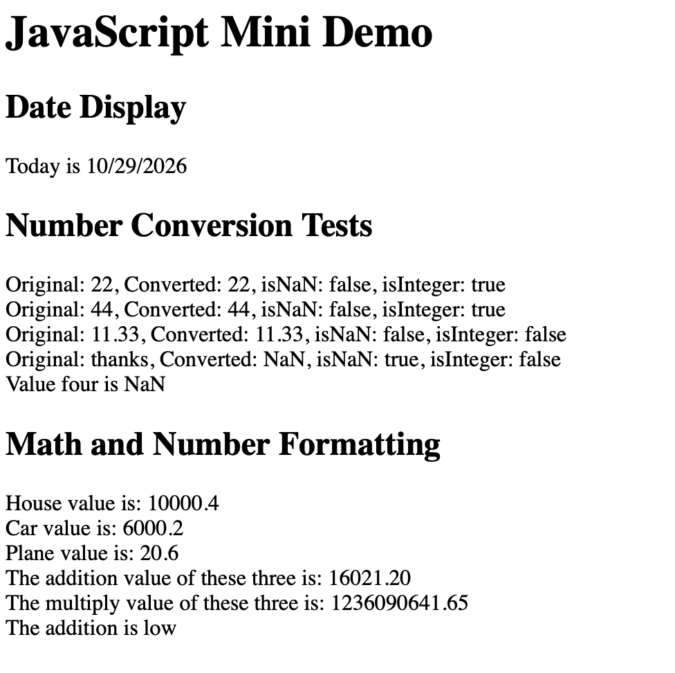

https://raphaekoerner1234d.github.io/comp484-hw9-main/

Built-in Objects and Methods:
- Date Object: new Date(), getDate(), getMonth(), getFullYear()
- Number Object: Number(), Number.isNaN(), Number.isInteger()
- Number Formatting: toFixed(2)
- DOM Method: document.getElementById()
- DOM Properties: textContent, innerHTML
- Conditional Statements: If else

Screenshot:
- 

Reflection:
- Easiest part was displaying the results on my website.
- Hardest part was converting string into numbers.
- Date object has many different formats. You can display it in various ways.
- Number object has many conversion and checking methods.
- I learned how to display my JavaScript results and how to use DOM methods.